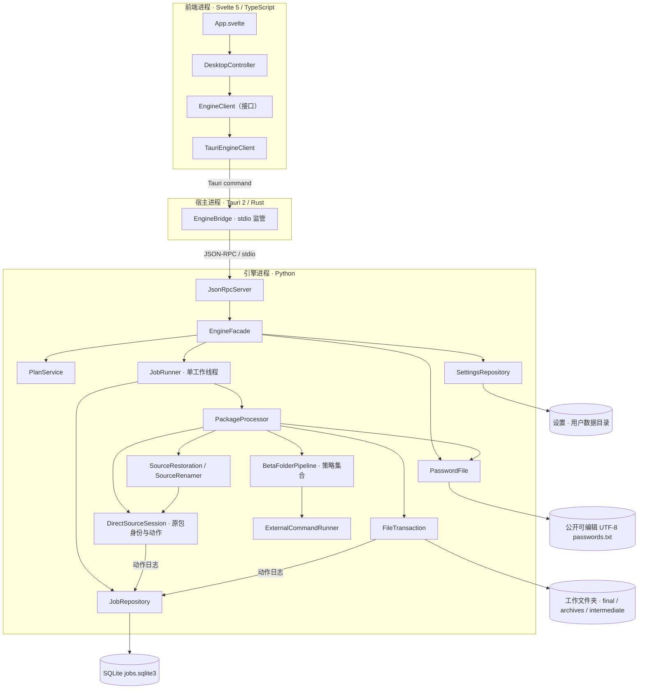
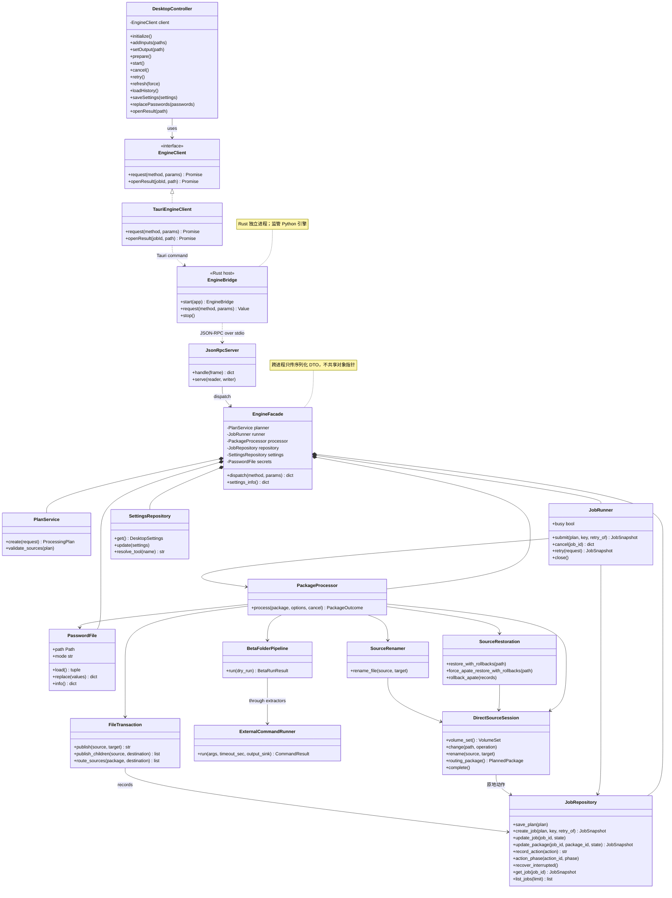
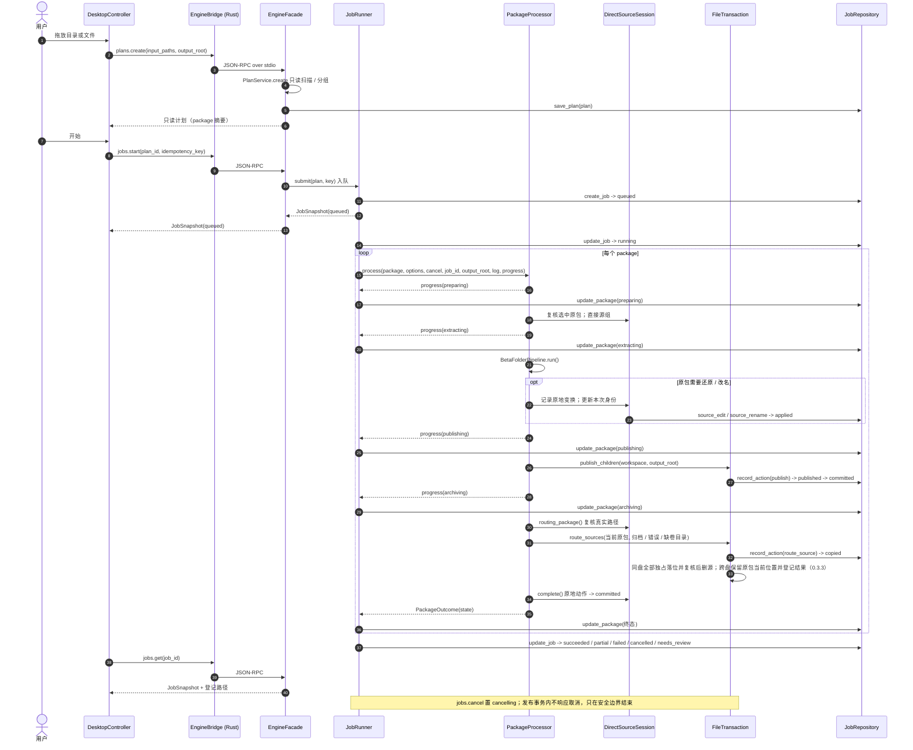
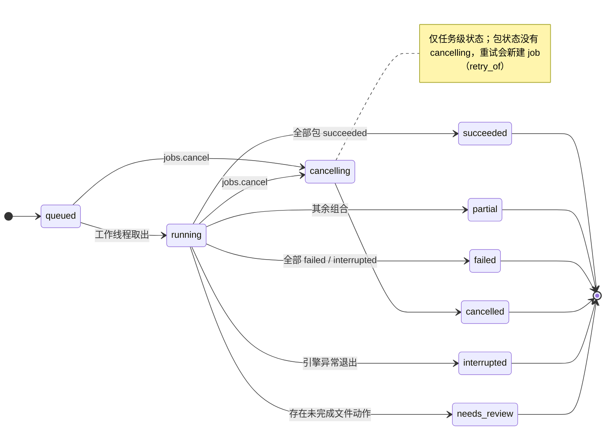
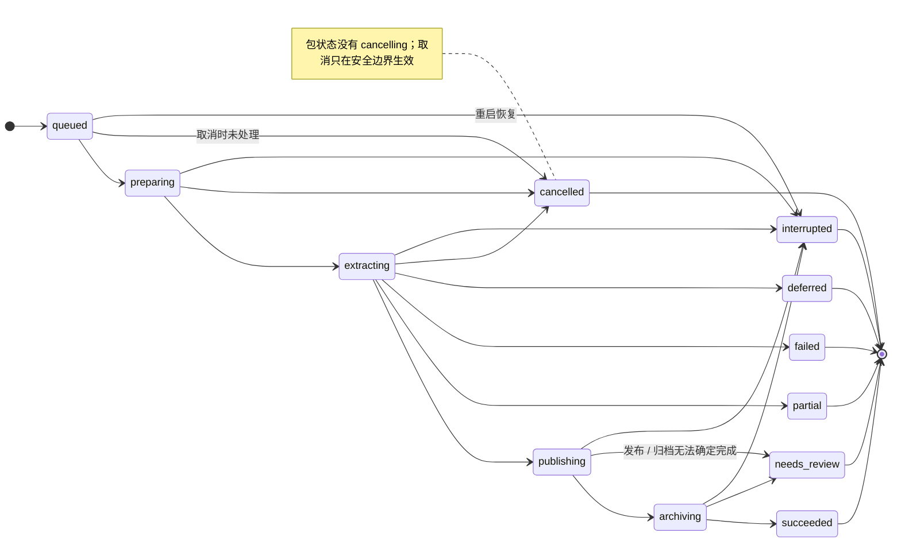
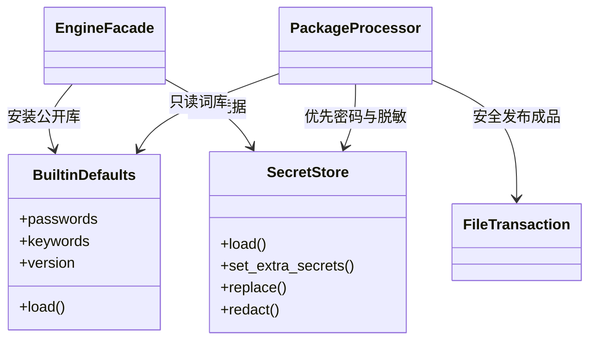
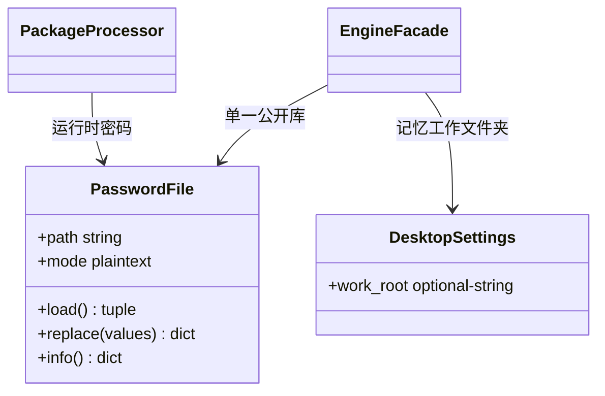

# 桌面首版工程设计与实施契约

日期：2026-10-07；2026-10-08 增补 0.3.1；2026-10-12 增补 0.3.2；2026-10-13 增补 0.3.3；2026-10-18 增补 partial 输出隔离契约。产品依据：[产品方案](product_plan.md)。
状态：设计与各版本历史实施记录见下文；2026-10-18 规则更新仅适用于当前源码，未更新 0.3.3 ZIP。实现、机器检查与人工验收状态由 [实施状态](desktop-status.md) 记录。

## 1. 首版验收范围

跨平台桌面架构，Windows x64 首交付。保留 CLI；桌面提供目录/文件拖放、只读计划、单队列执行、取消、错误重试、最近任务、密码与工具设置、结果打开。
不在首版加入浏览器服务器、目录监听、托盘自动处理、云服务或 Agent。

当前源码直接读取选中原包，按适用的密码、工具与恢复路径尝试，只有完整成功才报告完成。错误密码、非零退出或 CRC/Data Error 即使有非空输出也不算成功；全部适用尝试失败后，partial 状态显示“未完成，待检查”，输出进入 `incomplete/outputs/<包名>/`，原包全卷按原 basename 进入 `incomplete/archives/` 根目录，同名冲突沿用既有去重；不额外创建包级 archives 目录。partial 只保留一份候选/最新非空输出，不承诺选择“最好”的结果。跨盘原包保留在原位置并登记；不使用整包备份/恢复副本。该 2026-10-18 契约未回写 0.3.3 ZIP。

2026-10-14 的旧 BAT 兼容切片继续复用 `BetaFolderPipeline` / `ExtractionService`，CLI restoreAB 同样改为原地接口。BAT 的 `--workdir` 是程序与配置仓库，`--folder` 是输入及结果的工作文件夹；工具临时目录属于后者。公共 Windows 启动器负责定位仓库和 Python，固定工具准备复用既有锁验证与 staging；不进入 Tauri / Rust / 前端调用链。CLI 展平和 basic/smart 预设保留，桌面选中范围和默认界面不变。证据及部署入口见 [实施状态](desktop-status.md)。

## 2. 依赖方向与对象职责

| 对象 | 接口与责任 | 所拥有的资源 / 生命周期 |
|---|---|---|
| DesktopController | initialize/prepare/start/cancel/retry/loadHistory/saveSettings；把业务快照转成界面状态 | 当前计划、任务、轮询订阅；关闭时释放 |
| EngineClient | request(method, params)；唯一前端引擎接口 | IPC 请求；所有 UI 都依赖这个接口 |
| TauriEngineClient | 使用受限的 Tauri command 实现 EngineClient | 不操作文件、不持有密码 |
| EngineBridge（Rust） | 启动引擎、请求匹配、读取响应、引擎退出、结果打开 | 子进程、管道、待响应请求；应用级对象 |
| JsonRpcServer（Python） | 验证协议、路由白名单、序列化响应 | stdin/stdout；控制读取独立于任务线程 |
| EngineFacade | 系统信息、计划、任务、配置、结果的稳定入口 | 组合其他对象；不实现解压规则 |
| PlanService | 只读输入扫描、分组、源快照、冲突与路径检查 | 计划 DTO；不能移动文件或自动下载工具 |
| JobRunner | 单执行队列、取消、重试、终态与中断恢复 | 一个执行线程、每任务取消信号；引擎级对象 |
| PackageProcessor | 准备工作区、调用现有管线、检查输出、生成包结果 | 一个包的工作区（0.3.1 起在工作文件夹 `intermediate/workspaces/` 下）和 Runner |
| DirectSourceSession | 选中源身份、原地改写/改名动作与当前路由快照 | 每包一个对象；无需源字节副本 |
| FileTransaction | 写入动作记录，发布输出，再路由真实原件 | 文件句柄、动作状态；包级对象 |
| JobRepository | SQLite 数据版本、任务/包/事件/动作持久化与分页 | 一个受锁保护的连接；唯一数据库写入口 |
| SettingsRepository | 读取/验证普通配置，工具路径与能力 | 用户数据目录；与项目样例 config 分离 |
| PasswordFile（原 SecretStore） | 读写公开密码库文件；设置 DTO 返回 values/path/count | 数据目录下的 `passwords.txt`；明文、无凭据后端 |
| ExternalCommandRunner | 有界日志、时间期限、取消、进程树控制 | 每次工具调用的子进程和输出读取线程 |

组合优先；已有 RestorerStrategy、ExtractorStrategy、VolumeGroupingStrategy 保持不变。
DTO 使用明确的输入/输出模型；只有持有状态和生命周期的部分设计成对象，不为了面向对象增加万能基类。

## 3. 类图

下图 `*--` 为组合、`-->` 为调用依赖、`..>` 为跨进程适配、`<|..` 为接口实现；Rust 与 Python 分属不同进程。

Rust 的 EngineBridge 与 Python 的 EngineFacade 属于不同进程，不是互相继承的类。
跨进程只能传序列化 DTO，不能共享 Python 对象指针或 Rust 引用。

类图仅列主要参数；完整关键字参数与构造函数资源以源码为准。`ExternalCommandRunner` 的 cancel_event/guard 属于构造依赖，`EngineBridge.start(app, portable)` 选择默认用户目录或显式便携数据目录。

## 4. 数据模型与不变量

### ProcessingPlan

- plan_id、created_at、options、output_root、packages。
- 每个 package：package_id、entry、members、group_key。
- 每个源成员：absolute_path、size、mtime_ns；拒绝符号链接/非普通文件。
- input_paths 由明确的系统对话框或拖放输入；选文件只处理所选文件组成的完整组，不处理旁边未选文件。
- 输出不能覆盖软件安装目录或工作区，不接受空/相对/越界路径。
- 开始前重验源快照；计划改变必须重新扫描。
- 源路径为真实选中文件；本次原地变换后的路径/身份由 DirectSourceSession 更新，外部变化拒绝采纳；包 ID 在所有阶段稳定。

### JobSnapshot / PackageOutcome

- job_id、state、created_at、updated_at、counts、packages、last_seq。
- 包状态区分 succeeded、partial、failed、deferred、cancelled、interrupted、needs_review；当前源码的 `partial` 表示“未完成，待检查”，不代表成品完成。
- results 保存已登记成品、原件归档与错误位置。
- 任务库不存密码；公开密码只在数据目录的 `passwords.txt` 里，日志与错误不再掩码（见第 12 节）。
- 一个源文件同一时间只能属于一个活跃执行任务。

### OperationRecord

- action_id、job_id、package_id、kind、source、destination、phase、source_size、source_mtime_ns。
- phase：发布/归档 prepared → copied/published → source_removed → committed；原地操作 prepared → applied → committed（整组归档完成），无变化则 abandoned。
- 记录意图再执行文件操作；不能把 SQLite commit 等同于文件系统事务。
- 中断后检查真实路径与身份，禁止盲目删除原件或全任务自动重跑。

## 5. 通信契约

JSON-RPC 2.0 over UTF-8 JSON Lines；protocol_version=1。
stdout 只写完整协议帧，stderr 只写诊断；最大帧 1 MiB。
UI 不启动任意程序，不传任意 shell 命令。Rust 与 Python 各维护明确业务白名单。

| 方法 | 输入 | 输出 / 幂等 |
|---|---|---|
| system.info | 无 | 引擎版本、协议、平台、工具与能力 |
| plans.create | input_paths、output_root、options | ProcessingPlan；只读 |
| jobs.start | plan_id、idempotency_key | JobSnapshot；同 key 返回同任务 |
| jobs.get / jobs.list | job_id / limit | 快照 / 最近任务 |
| jobs.cancel | job_id | 是否已接受取消；终态通过快照获得 |
| jobs.retry | job_id、package_ids、idempotency_key | 新任务；只重做明确失败/中断包 |
| jobs.events | job_id、after_seq、limit | 有界事件页 |
| jobs.logs | job_id、cursor、limit | 日志页；公开密码不掩码（见第 12 节） |
| settings.get / settings.update | 受限选项、`work_root` | 设置快照、工具状态、密码 path/count/values |
| passwords.replace | 用户主动提供的密码列表 | 数量、路径、明文列表（`storage=plaintext`） |
| results.get | job_id | 注册的输出路径 |

设置包括 7z/可选工具路径、深度上限、识别阈值、保留 payload 名称、最大输出空间、工具超时、工作区保留。
首版 UI 使用适度快照轮询；控制接口和引擎任务线程独立，取消可及时读取。可在同契约上增加推送，不能让 UI 解析日志判断状态。

错误分两层：协议错误（非法 JSON、方法不存在、参数错误）、业务错误（INPUT_CHANGED、BUSY、DISK_FULL、UNSAFE_ARCHIVE、TOOL_TIMEOUT、ARCHIVE_ROUTE_FAILED 等）。取消是独立终态，不伪装成密码错误。

## 6. 一次处理的时序

重试为新的 job_id，保留与旧任务的关联；旧成功包不重做。
取消在发布事务的安全边界检查，不能中断一半的源文件删除后直接报告 cancelled。

## 7. 状态与异常流程

任务级与包级是两套独立状态机：`JobSnapshot.state` 含 `cancelling`，`PackageSnapshot.state` 不含 `cancelling`。

**任务（JobSnapshot.state）**

**包（PackageSnapshot.state）**

不同错误的最终位置：

| 结果 | 输出 | 原件 |
|---|---|---|
| 完全成功 | final | success/archives |
| 全部适用尝试失败但保留非空输出 | incomplete/outputs/<包名> | incomplete/archives/（原 basename；冲突去重）；跨盘则留原处并登记 |
| 完全失败 | 错误说明 | error_files/分类 |
| 缺卷 | deferred 结果 | deferred_volumes/组 |
| 取消 | 无变化可取消重试；原地改动后 needs_review | 按实际名称/内容与动作记录核对 |
| 归档异常 | 已生成的成品登记保留 | 剩余原件保留并标记 needs_review |

动作日志协调恢复；没有真实 7z 流内续传承诺。

## 8. 进程与安全边界

- 宿主监管引擎，Runner 监管工具；Windows 使用进程树终止实现，Unix 使用进程组。
- 工具输出通过后台读取与有界队列传递；独立期限检查，解决当前 stdout 阻塞导致 timeout 不生效的问题。
- 只保留有界日志尾部，完整日志滚动写盘；禁止无限 collected。
- 归档成员预检、输出检查、拒绝越界路径/危险链接、空间和层数限制。
- 引擎的路径校验不依赖前端：即使直接构造 IPC 请求也必须约束操作。
- 不执行解出的文件，默认无网络服务。
- 公开密码库按明文文件处理：不再使用系统凭据后端，日志与错误不再对密码做掩码；私人密码不应写入该文件。
- 工作目录和 Rust 的内存安全不代表操作系统沙箱；第三方解压器仍需版本维护。

## 9. 实施分工与验证边界

本会话委派链路存在任务正文丢失；主线程实施，所有模块保持明确文件所有权，后续兼容会话可独立委派。

| 切片 | 文件范围 | 最小验收 |
|---|---|---|
| 引擎数据与计划 | application/models、planning | 参数验证、选文件范围、分组、输入变化 |
| 任务与文件事务 | application/jobs、processing；infrastructure/job_repository、file_transaction | 成功/部分/失败/取消/中断、原件字节与路径 |
| 进程/安全/秘密 | command_runner、archive_safety、secret_store（PasswordFile） | 有界日志、超时、取消、恶意路径、公开密码文件的读写与边界 |
| 桌面桥接 | apps/desktop/src-tauri | Rust 编译、坏协议、进程退出、命令白名单 |
| 界面 | apps/desktop/src | 类型/构建、Controller 状态切换、简单操作 |
| 发布与指导 | scripts、docs | Windows 打包 smoke、产物资源与文档链接 |

数据完整性和取消跨越多个模块，因此必须做定向集成验证；真实特殊格式和主观界面体验由用户验收。
所有“通过”必须对应命令、退出状态和最终文件状态，不能只写“无 bug”。

## 10. 学习文档组织

- 本文：先看依赖图、对象职责、类图，再看时序与状态。
- docs/desktop-code-guide.md：按一个按钮追踪到源文件，解释对象组合和错误处理。
- docs/desktop-language-guide.md：TypeScript/Svelte/Rust 与 Python/Java/C++ 的对照；聚焦本项目用到的语法。
- docs/desktop-user-guide.md：下载、运行、设置、结果和人工验收操作。
- docs/desktop-status.md：实际完成范围、检查证据、未验证能力与待办。
- docs/diagrams/：可维护图源（architecture.json、modules.mmd、classes.mmd、sequence.mmd、states.mmd、package_states.mmd），SVG 就地生成。
- artifacts/diagrams/continuation/：PNG 预览与 render 报告（git 忽略）。
- 重现命令：`rtk proxy /usr/local/bin/python scripts/render_desktop_diagrams.py`（`--list` 列出全部图，`--only <name>` 只渲染一张）。

## 11. 0.3.0 内置库与外观对象

已批准品牌星绫解封 · Hoshiribbon，内部包名与 Tauri identifier 保留。两种对象寿命独立：公开 catalog 随安装版本固定，私人 SecretStore 属用户或当前会话。Facade向DTO只暴露条数、版本与开关；Processor组合密码并只清理成品顶层名。公开密码也加入日志脱敏。

`use_builtin_passwords` 默认 true；`clean_builtin_keywords` 默认 false（用户已确认），后者不改变原件、归档名或内部路径。词库文件与清单都验证路径/链接/大小/hash/条数，源码打包锁固定身份。前端 `appearance.ts` 仅处理本地外观：白名单 data URL、类型、2 MiB、解码尺寸和存储回读，无新增 Rust 权限，不进入任务数据库。

本节是 **0.3.0 历史记录**：0.3.1 起 `SecretStore` 被明文 `PasswordFile` 取代，"内置密码开关 + 私人库"两套来源合并为单一可编辑文件，见下节。关键词清理语义不变。

## 12. 0.3.1 公开密码文件与工作文件夹对象

要点：

- `PasswordFile` 继承旧 `SecretStore` 名称以兼容注入适配器，但生产路径不再有 keyring / 会话内存后端；`mode` 固定为 `plaintext`，`info()` 返回 `path`、`count`、`values` 与 `storage`。
- 文件只在不存在时生成并播种一次；`load()` 每次读盘，所以外部编辑在下次使用时生效，空文件表示“故意清空的空库”。
- 密码需每行一个、UTF-8，单条上限 4096 字符、最多 10000 条、文件不超过 512 KiB；超限报 `INVALID_PASSWORD_FILE`。这些边界配合 1 MiB 协议帧，避免整库回传把响应撑爆。
- `DesktopSettings` 增加 `work_root`；`ProcessingOptions.use_builtin_passwords` 仅作为旧配置兼容字段保留，实际以文件为准。

工作文件夹的对象关系不变：`PackageProcessor` 仍在包级工作区上跑 `BetaFolderPipeline`，只是 0.3.1 起把工作区根从数据目录 `work/` 换成所选工作文件夹的 `intermediate/workspaces/<作业>/<文件组>/`，并在其中设定解压工具的 TEMP/TMP/TMPDIR 与当前目录。旧数据目录 `work/` 只保留作只读遗留恢复；发布与原件整理优先同盘独占移动/改名。机器证据由主线程汇总，本文不预判通过。（本节为 0.3.1 历史；跨盘行为已由 0.3.3 改为保留原包当前位置，见第 14 节。）

## 13. 0.3.2 直接源适配

PackageProcessor 为每包创建 DirectSourceSession，SourceRestoration/SourceRenamer 包住旧管线的还原和改名入口。BetaFolderPipeline 增加可选 volume_sets、manage_originals 与 renamer；桌面传真实源组、关闭内核归档，由 FileTransaction 集中路由，CLI 默认不变。还原 workspace 参数被限制在本次工作区，避免多卷旧入口把派生产物落到源目录。结果列表不把历史 source_edit/source_rename 路径当成产物，needs_review 仍返回动作供人工核对。

同盘无整包预拷贝，Windows 无硬链接可独占改名；多层解压与部分失败输出仍有必要写入。普通 ZIP、源身份、中断、旧命名/嵌套和 Windows 冻结引擎证据见实施状态；真实大盘与 GUI 不在机器验收范围。（本节为 0.3.2 历史；0.3.3 把桌面 restoreAB 改为原地修复、跨盘改为保留原包当前位置，见第 14 节。）

## 14. 0.3.3 磁盘读写优先适配

本节记录 0.3.3 已实现的对象与契约变化；以类/函数名定位，不引用会漂移的行号。仅列与设计有关的差异，压缩/密码/深度等旧策略不变。

### 14.1 六类核心处理方式

`PackageProcessor` 装配 `RestorationService`，桌面顺序为 `RestoreABRestorer(in_place=True)`、`ApateRestorer(rounds=3)`、`EmbeddedArchiveRestorer`、`SuffixVariantBuilder`。每个文件组的方法标记由此与管线派生：

- 直接解压 `direct`；后缀改名 `direct+rename:<规则>`（`SuffixVariantBuilder.plan_variants` + `RenameSession`）。
- Apate 还原 `apate-reveal`、嵌入封面剥离 `embedded-archive-strip-prefix`（`_probe_method` / `_restore_method`；类型 APATE/EMBEDDED 经 `preferred_kind` 优先对应还原器）。
- restoreAB 原地 `restore-ab-in-place`（仅真正的原地 RestoreAB 编辑才用该标签）。
- 强制 Apate 兜底 `apate-force-reveal`（`_force_apate_attempt_if_useful`，名字 one/two/three 提示轮数）。

后缀改名规则 `SuffixVariantBuilder` 现注册 **7 条**（0.3.2 基线 5 条，本轮新增 `media-to-zip`、`no-suffix-to-zip`）；分卷归一化 `BetaFolderPipeline` 有 **4 条**（`disguised-split-suffix`、`sfx-volume`、`numbered-tail-volume`、`middle-numbered-volume`）。嵌套层与分卷数量不与方式分类累加。

### 14.2 原地 restoreAB

`RestoreABRestorer(in_place=True)`：单 `r+b` 句柄，先规划校验再前移 + `truncate` + 回写 ZIP 偏移，`restore_with_rollbacks` 原地返回同路径、空回滚；`_build_zip_plan` 对 ZIP64/布局异常在写前抛 `RestoreABError`。`in_place=False` 的旧派生语义保留给 CLI（`beta.py`）。`SourceRestoration` 仍把 workspace 限制在本次工作区。

### 14.3 结果保留与尝试停止契约

0.3.3 的“非零退出但已有非空文件就停止并显示完成有警告”是历史策略，已被 2026-10-18 当前源码契约替代：

- 错误密码、非零退出或 CRC/Data Error 均表示当前尝试失败，即使已有非空文件也不能报告成功。每次尝试的输出隔离，失败文件不能污染后续成功；完整成功后才可提前结束。
- 遍历配置密码、可用工具与适用的直接解压 → 原地后缀调整 → 必要伪装还原路径。真实格式不匹配时可切换工具并跳过该工具的密码轮询。缺卷、权限、空间不足、取消、超时与安全失败硬停止，不盲目重试。
- 尝试失败且无完整成功时，不为每次尝试永久留副本；只保留一份候选/最新非空 partial，不承诺“最好”的结果。全部适用尝试完成后若仍有非空文件，状态 `partial`，界面显示“未完成，待检查”，输出进入 `incomplete/outputs/<包名>/`，完整分卷原包按原 basename 进入 `incomplete/archives/` 根目录，同名冲突去重，不额外创建包级 archives 目录；不进入 final/success。跨盘原件留在原位置并登记。无文件失败仍进 `error_files/`，缺卷留在 `deferred_volumes/`。
- 内层解压的 partial 仍是未完成状态；不能把外层任务标记为完整成功。未知普通文件沿用旧停止策略。
- 不使用整包备份或恢复副本，结果仅在同一工作区内移动。
- 真实用户 `393.7z.001/.002` 尚未执行人工验收。

`ExternalCommandRunner.run` 的每调用 `abort_on_line`、`tools.py` 的 `_extract_abort_guard` 与命令行选项仍按具体工具实现；以上状态规则不将非空输出本身视为成功条件。

### 14.4 原包归档

`FileTransaction.route_sources(package, destination, copy_across_volumes=False)`：跨盘时登记已核验的当前路径（动作 `retain_source`）并返回，不改字节；同盘仍走 `_route_sources_in_place`。`PackageProcessor` 传入该参数并在跨盘时向结果追加“已保留原包当前位置，未复制归档”。因此桌面不再需要跨盘整包复制，也不需要 restoreAB 派生副本。

### 14.5 工具

随包 7-Zip 由 25.01 受控升级到 26.04（`scripts/desktop-sevenzip.lock.json`，25.01 历史保留），UnRAR 7.13.0 / Bandizip 7.40.0.1 固定；bsdtar 本版不捆绑，ALZ/EGG 不宣称支持。来源与退出语义见 [工具研究](desktop-tool-research.md)。

### 14.6 未验证

真实大盘 I/O、真实原件上的跨盘保留与原地 restoreAB、7-Zip 26.04 冻结引擎行为，以及 393.7z 分卷的完整成功/partial 结果，均未完成真实用户样本人工验收；状态见实施状态。
